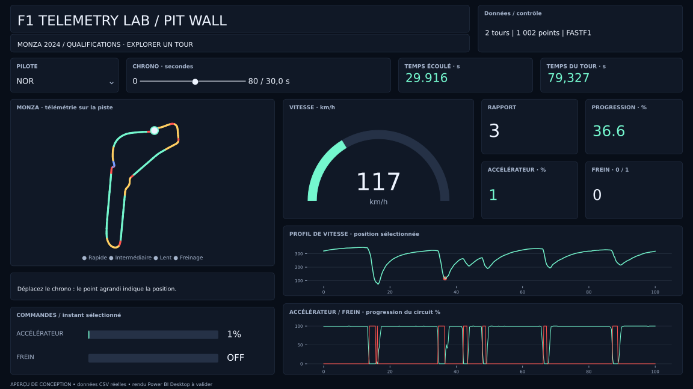
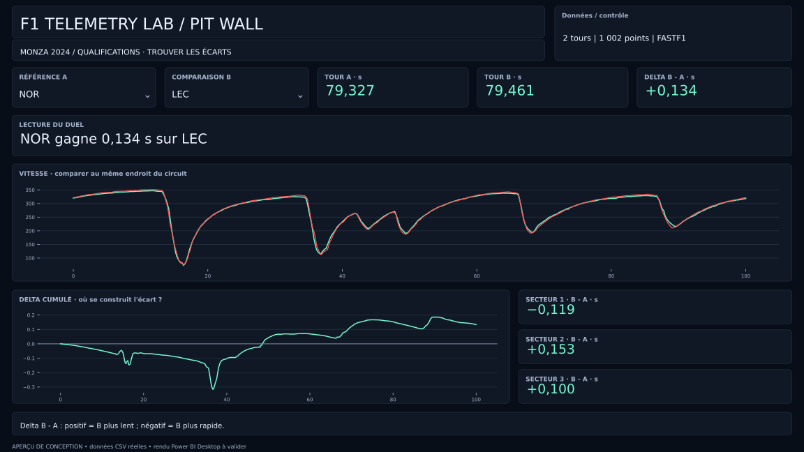
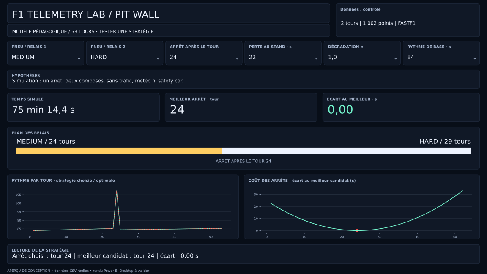

# Refonte 0.2 — Pit Wall

Le premier livrable était une base technique. Cette itération améliore le rapport et ses interactions, sans présenter le projet comme déjà validé dans Desktop.

## Changements

| Avant | Version 0.2 |
|---|---|
| Liste de 501 bins | Curseur de chrono 0–80 s, pas de 0,1 s |
| Segments sans valeurs enregistrées | NOR à 30 s, duel NOR/LEC, stratégie MEDIUM/HARD |
| Grande image SVG de piste dans une table | Piste en nuage de points natif, zones de télémétrie et point sélectionné agrandi |
| Indicateurs dispersés | Jauge, rapport, progression, pédales et marqueur de vitesse synchronisés |
| Résultats sans explication | Messages « Lecture du duel » et « Lecture de la stratégie » |
| Durée totale seule | Plan des relais, comparaison du rythme choisi/optimal et pénalité des candidats |
| Clics pouvant modifier le contexte | Interactions des graphiques neutralisées ; les paramètres pilotent le rapport |

## Aperçus de conception

Ces images sont produites avec Matplotlib à partir des positions PBIR et des CSV réels. Les calculs de l'aperçu sont exécutés en Python. Ce ne sont **pas des captures Power BI** : taille des polices, légendes, proportions et contrôles peuvent différer. La recette Desktop reste obligatoire.

Pour les reproduire :

    python -m pip install -e ".[preview]"
    python scripts/design_preview.py

## État de validation

| Contrôle | État |
|---|---|
| Données, endpoints et secteurs | Tests automatisés |
| Formules Python et recherche de l'arrêt optimal | Tests automatisés |
| Sélections enregistrées et filtre du curseur | Contrôle structurel |
| Canevas, références, absence de chevauchement | Tests automatisés |
| Schémas JSON Microsoft | Validation automatisée |
| Mise en page des aperçus | Inspection des trois images |
| Parseur TMDL, moteur DAX et rendu de la version 0.2 | À vérifier dans Desktop |
| Fluidité et export PBIX | À vérifier dans Desktop |

Le replay automatique, les températures et l'usure réelle des pneus ne sont pas livrés. La suite doit valider la 0.2 puis choisir et intégrer un composant de lecture adapté, en gardant tous les indicateurs synchronisés.
